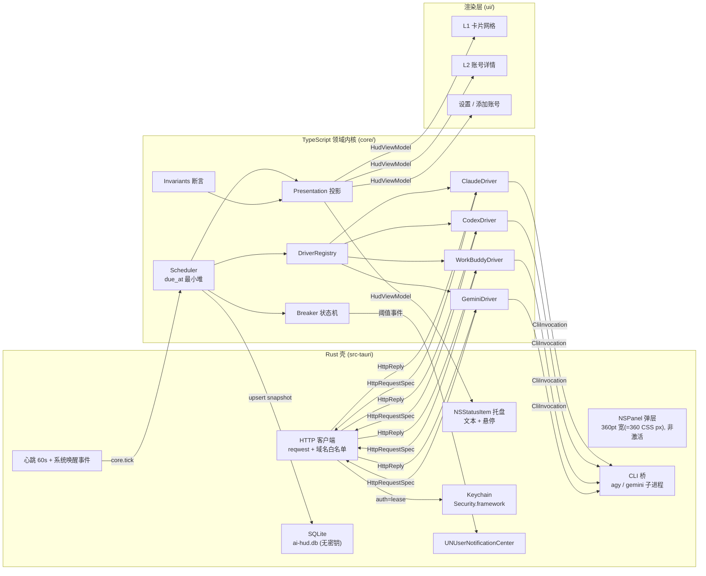
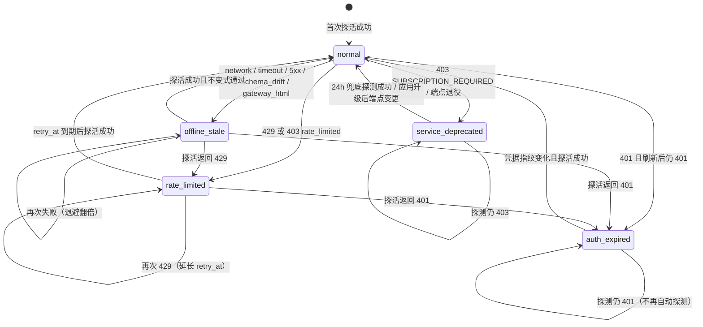
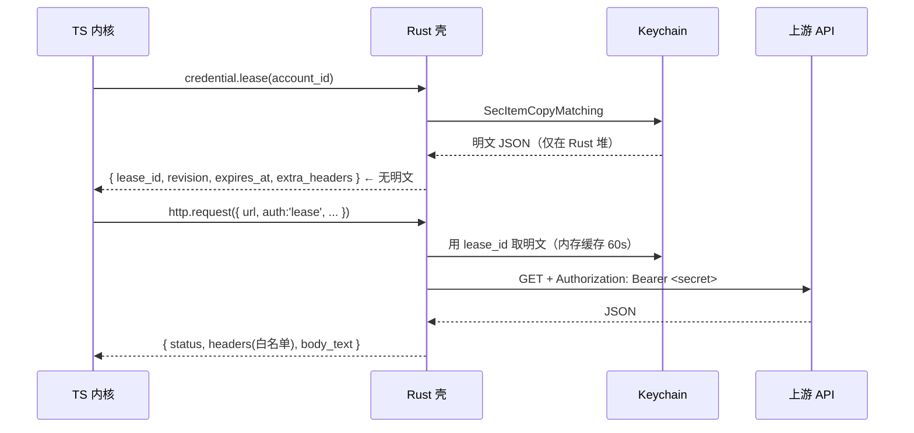

# AI HUD 架构设计（v1.0 / 实现契约）

| 项目 | 值 |
| :--- | :--- |
| 文档状态 | 已定稿，作为 `core/`、`ui/`、`src-tauri/` 的实现契约 |
| 取代 | `docs/ARCHITECTURE.v0.md`（草案，Rust 侧定义领域模型的主张已被本文第 8 章否决） |
| 目标平台 | macOS 14.0+（Apple Silicon + Intel，`universal-apple-darwin`） |
| 技术底座 | Tauri 2 = Rust 壳（AppKit / Security.framework / reqwest / SQLite）+ TypeScript 领域内核 + WebKit 渲染层 |
| 首发渠道 | claude、codex、workbuddy、gemini（workbuddy 为必选渠道） |
| 关联文档 | `docs/FLOWS.md`（流程与边界）、`docs/PROTOTYPE-SPEC.md`（逐屏规格）、`prototype/reference-v11.html` / `reference-v12.html`（已验证视觉基线） |
| 代码标识符 | 英文；领域模型与 IPC 载荷统一 `snake_case`；界面文案简体中文 |

本文只回答一个问题：**每个产品硬规则由哪个字段、哪个接口、哪条状态迁移来保证**。凡是不能落到类型定义、函数签名或状态迁移表的表述，一律不写。

---

## 0. 术语与不变式速查

| 术语 | 定义 |
| :--- | :--- |
| 读数（reading） | 一次成功探活解析出的额度事实，`QuotaReading`，只有两种形态：窗口或积分池 |
| 快照（snapshot） | 账号的完整领域状态 = 身份信息 + 最近一次读数 + 健康状态 + 调度元数据 |
| 投影（projection） | 由快照 + 当前时刻计算出「可渲染视图模型」的纯函数，是规则 1/2/6 的唯一实现点 |
| 熔断（breaker） | 每个账号独立的健康状态机，只影响该账号的请求节奏与展示，不影响其他账号 |
| 租约（lease） | Rust 侧指向 Keychain 明文的临时句柄，TS 侧只能看到 `lease_id` 与非敏感元数据 |
| 未知（unknown） | 没有可信读数的状态；在类型上用 `null` 表达，**永不用 0 表达** |

全局不变式（`core/src/domain/invariants.ts` 逐条断言，单测覆盖）：

| ID | 不变式 | 违反后果 |
| :--- | :--- | :--- |
| I1 | `state === 'normal'` ⇔ `reading !== null ∧ reading_observed_at === last_success_at ∧ retry_at === null` | 百分比可能被渲染在非可信状态上 |
| I2 | `reading === null` ⇒ `reading_observed_at === null ∧ last_success_at === null` | 出现「首次同步前就有数据」的幽灵值 |
| I3 | 每个 `remaining_ratio ∈ [0,1]` 且非 NaN；百分数格式化结果 ∈ [0,100] | 环溢出、文字显示 103% |
| I4 | `reading.kind === 'windows'` ⇒ `windows.length ≥ 1` 且 `id` 唯一 | 卡片空环 |
| I5 | `visual_kind` 与 `reading.kind` 严格对应（见 3.2） | 积分池被画成双环 |
| I6 | `state !== 'normal'` ⇒ 投影的 `primary_slot.kind !== 'percent'` | 直接违反硬规则 1 |
| I7 | `exhausted === (remaining_ratio === 0)` | 「耗尽」与空环不一致 |
| I8 | `region !== 'global'` 仅允许出现在 `workbuddy` | 站点与凭据错配无法识别 |
| I9 | `state === 'normal'` ⇔ `consecutive_failures === 0` | 退避与展示状态漂移 |
| I10 | 缺失数值一律 `null`，禁止 `0` 兜底（类型层 `number \| null`，不使用 `?? 0`） | 读不到被渲染成 0% |

---

## 1. 硬规则 → 架构落点对照

| 硬规则 | 落点（字段 / 接口 / 迁移） | 验证手段 |
| :--- | :--- | :--- |
| 1 只有 Normal 展示百分比 | `AccountHealthState` + 投影 `toCardView()` 的 `primary_slot`；I6 | `presentation.spec.ts` 五状态快照表驱动快照测试 |
| 2 禁止把读不到渲染成 0%/100% | `reading: QuotaReading \| null`；`remaining_ratio` 只由服务端可信字段推导；I2、I10 | 反例 fixture（空 body / HTML 网关页 / 缺窗口）断言投影 `primary_slot.kind === 'status'` |
| 3 单渠道独立熔断 | 熔断器按 `account_id` 实例化，退避期间从调度堆移除；并发槽不占用 | `breaker.spec.ts` 用假时钟并发跑 4 账号，断言 1 个 429 不影响其余 3 个的 `due_at` |
| 4 凭据不明文落盘 / 零明文日志 | `CredentialLease`（无明文）+ `AuthBoundHttp`（token 由 Rust 注入）+ `CredentialPatchSpec`（刷新写回由 Rust 执行） | `tests/security-scan.sh` 扫 fixtures/logs/DB；`ipc.spec.ts` 断言命令返回值不含 token 键 |
| 5 不提前刷新 token | `evaluateRefreshGate()`：仅 `expires_at <= now` 或 fetch 返回 401 时返回 `refresh` | `refresh-gate.spec.ts` 覆盖 5 种 `expires_at - now` 区间 |
| 6 环编码剩余 | `QuotaWindow.remaining_ratio = 1 - used_ratio`，驱动层完成翻转；`colorBand()` 按剩余分档 | `format.spec.ts` 断言 0.19→red、0.2→yellow、0.5→green；`sort` 断言升序 |
| 7 Apple HIG | 见 3.2 / 5.6 的几何与动效参数表（材质、发丝边、9.5pt、tabular-nums、280ms、Reduce Motion） | `ui/` 快照对比 + Reduce Motion 开关下的 `transition-duration: 0` 断言 |
| 8 渠道差异只在数据格式与展示形态 | `ChannelDriver` 只允许差异出现在 `fetch_snapshot` / `refresh_token` / `poll_policy` 与 `deriveVisualKind()`；调度器、熔断器、投影、存储对渠道零分支 | `tests/layering.spec.ts` 静态扫描：`core/src/scheduler`、`core/src/domain/health.ts`、`core/src/presentation` 不得出现 provider 字面量 |

---

## 2. 运行时拓扑



三条不可跨越的边界，画在图上就是三道箭头约束：

1. **TS 永不持有明文凭据**：驱动只声明「用租约签名这个请求」，明文注入发生在 Rust 的 `HTTP` 节点内（7.2）。
2. **Rust 永不做业务判断**：托盘文本、告警阈值、状态文案全部来自 `HudViewModel`；Rust 只搬运与渲染（8.1）。
3. **渲染层不读快照，只读投影**：`ui/` 拿不到 `AccountSnapshot`，只能拿 `AccountCardView`，因此不存在「某个组件忘了判断状态就画百分比」的可能（3.8）。

---

## 3. 统一领域模型

代码位置 `core/src/domain/types.ts`。所有类型 `readonly`，跨 IPC 以 JSON 传输，字段名 `snake_case`（与 Rust serde 同构，避免双向改名层）。

### 3.1 ProviderKind

```ts
/** 内置渠道字面量：可穷尽 switch，新增渠道必须改这里才会编译报错 */
export type BuiltinProviderKind = 'claude' | 'codex' | 'workbuddy' | 'gemini';

/** 对外渠道标识：内置 + 插件扩展位（模板字面量，序列化为字符串） */
export type ProviderKind = BuiltinProviderKind | `custom.${string}`;
```

| 取值 | 语义 | 约束 |
| :--- | :--- | :--- |
| `claude` | Anthropic 订阅账号 | 凭据来自 Claude Code Keychain 条目或 `~/.claude/.credentials.json` |
| `codex` | OpenAI Codex / ChatGPT 订阅账号 | 凭据为 `~/.codex/auth.json` 或 keyring，需 `ChatGPT-Account-Id` 头 |
| `workbuddy` | 腾讯 WorkBuddy / CodeBuddy 积分账号 | 必须带 `region ∈ {cn, intl}`，站点是账号身份的一部分 |
| `gemini` | Google Gemini / Antigravity | 消费级旧接口已停服，需走 CLI 或 Cookie 通道 |
| `custom.<id>` | 第三方扩展 | 未注册时 `registry.get()` 抛 `UnsupportedProviderError`，UI 落「不支持的渠道」行，不崩 |

为什么不用 v0 的 `Custom(u32)`：IPC 上是 JSON，数字枚举无法表达「未知插件」，且 `u32` 在跨语言边界上没有可读性；模板字面量在 TS 侧保留穷尽性检查，在 Rust 侧只是一个 `String`。

### 3.2 MetricVisualKind

```ts
export type MetricVisualKind =
  | 'dual_sliding_window'    // 双滑动窗口：外环短窗 + 内环长窗（同心双环）
  | 'single_periodic_window' // 单周期窗口：单大环
  | 'credits_pool';          // 积分池：积分环 + 绝对值
```

| 取值 | 数据前提 | 环几何（v11 基线） | 中心文字 | 右侧列 |
| :--- | :--- | :--- | :--- | :--- |
| `dual_sliding_window` | 两条及以上不同时长的窗口 | 52px；外环 r=22.6 / 3.8px，内环 r=16.4 / 3.4px，间隙 2.6px | 两窗中**剩余更低**者的百分数，13px Heavy | 两行：`外 5h 9% 恢 1h04m` / `内 1w 41% 恢 3d` |
| `single_periodic_window` | 仅一条窗口 | 48px；4.6px 描边（光学重量对齐双环） | 该窗剩余百分数 | 单行 + 一行灰字 `5h：无此窗口`（占位保持卡片等高） |
| `credits_pool` | 只有积分余额，无时间窗口 | 48px；4.6px | 剩余比例百分数（`total` 已知时）或 `—`（未知） | `15.2k / 20k` 绝对值 + 到期行 |

`visual_kind` 的**唯一来源**是 `deriveVisualKind(reading)`（`core/src/domain/visual.ts`），不硬编码在驱动内：

```ts
export function deriveVisualKind(reading: QuotaReading | null, fallback: MetricVisualKind): MetricVisualKind {
  if (reading === null) return fallback;              // 无读数时用驱动的骨架形态
  if (reading.kind === 'credits') return 'credits_pool';
  return reading.windows.length >= 2 ? 'dual_sliding_window' : 'single_periodic_window';
}
```

降级规则由此自然成立：claude 只返回 `five_hour` 时（上游字段缺失）自动变单环，而不是画一个内环 0% 的假双环。

### 3.3 QuotaWindow

```ts
export type EpochMillis = number;

export type WindowScope =
  | 'account'                          // 账号级窗口
  | { readonly model: string };        // 模型级窗口（codex）

export type AmountUnit = 'percent' | 'tokens' | 'requests' | 'credits';

/** 绝对量；服务端只给百分比时 used/limit 为 null（不臆造 token 数） */
export interface WindowAmount {
  readonly unit: AmountUnit;
  readonly used: number | null;
  readonly limit: number | null;
}

export type ReadingQuality = 'exact' | 'derived' | 'clamped';

export interface QuotaWindow {
  /** 稳定标识，用于跨次比对与通知去重：'five_hour' | 'seven_day' | 'model:gpt-5-codex:primary' */
  readonly id: string;
  /** 中文展示标签：'5 小时窗口' / '周窗口' / '积分包 2026-11' */
  readonly label: string;
  readonly scope: WindowScope;
  /** 窗口时长（秒）：18000 / 604800 / 86400；积分池为 null */
  readonly duration_secs: number | null;
  /** 剩余比例，0..1，环的唯一输入（硬规则 6） */
  readonly remaining_ratio: number;
  readonly amount: WindowAmount | null;
  /** 复位时刻（绝对毫秒）；上游给相对秒数时由驱动 + clock 换算，不存相对值 */
  readonly resets_at: EpochMillis | null;
  /** remaining_ratio === 0 */
  readonly exhausted: boolean;
  /** exact=上游直接给；derived=经换算/求和；clamped=越界后被裁剪 */
  readonly quality: ReadingQuality;
  /** 溯源：上游字段路径，如 'five_hour.utilization'，用于排障与审计 */
  readonly source_field: string;
}
```

字段语义与取值边界：

| 字段 | 语义 | 取值范围 / 兜底 |
| :--- | :--- | :--- |
| `id` | 窗口身份，参与通知去重与排序稳定 | 非空；同一快照内唯一（I4） |
| `label` | 界面文案，驱动提供 | 非空；≤ 12 全角字符（卡片单行） |
| `scope` | 账号级或某一模型 | `{model}` 时模型 slug 必须与上游一致，小写 |
| `duration_secs` | 用于「长窗/短窗」判定与文案（`5 小时` / `1 周`） | `null` 或 `> 0`；不知时长则 `null`，文案退化为服务端标签 |
| `remaining_ratio` | 剩余比例，**闭环语义** | `[0,1]`；越界裁剪并把 `quality` 置 `clamped`；`null` 不允许出现（无读数就是整个 `reading` 为 null） |
| `amount` | 绝对量，详情页展示 | 三项皆可为 null；`used > limit` 时裁剪为 `limit` 并 `clamped` |
| `resets_at` | 复位时刻 | 过去时刻保留但不显示倒计时（显示「待复位」），见 6.4 时间跳变 |
| `exhausted` | 撞限流标志 | 严格等于 `remaining_ratio === 0`（I7） |
| `quality` | 可信度 | `clamped` 的窗口在详情页加脚注「上游越界，已裁剪」 |

### 3.4 积分池 CreditsPool

workbuddy 与「无时间窗口」渠道的读数形态：

```ts
export interface CreditPackage {
  readonly id: string;
  readonly label: string;             // '2026-10 套餐包' / '赠送包'
  readonly total: number;
  readonly remaining: number;
  readonly expires_at: EpochMillis | null;
  readonly expired: boolean;          // 上游 expired=true：不计入可用余额
}

export interface CreditsPool {
  readonly unit: 'credits';
  readonly remaining: number;         // 可用总额
  readonly total: number | null;      // 上游总额；缺失则 null
  /** remaining/total；total 为 null 或 0 时为 null —— 此时环不画比例，只显示绝对值 */
  readonly remaining_ratio: number | null;
  readonly packages: readonly CreditPackage[];
  readonly expires_at: EpochMillis | null;  // 最近一个将到期的包
  readonly source_field: string;      // 'summary.totalRemaining'
}
```

`remaining_ratio === null` 是「不该画环」的合法表达：`deriveVisualKind` 仍返回 `credits_pool`，投影把环降级为**仅描边轨 + 绝对值**，绝不补 100%。

### 3.5 AccountHealthState

```ts
export type AccountHealthState =
  | 'never_synced'        // 账号已建、尚无任何成功快照（首刷中 / 首刷失败）
  | 'normal'              // 可信读数新鲜
  | 'offline_stale'       // 取不到可信读数：网络 / 超时 / 5xx / HTML 网关页
  | 'auth_expired'        // 401、刷新后仍 401、凭据被外部撤销、Keychain 不可读
  | 'rate_limited'        // 429 或 403 rate_limited，带 retry_at
  | 'service_deprecated'  // 403 停服 / SUBSCRIPTION_REQUIRED / 端点退役
  | 'parse_degraded';     // 2xx 但响应不可解析 / 字段缺失 / 数值越界（schema 漂移）
```

设计决策：**解析失败独立成 `parse_degraded`（第七态）**，不再并入 `offline_stale`。三条理由：① 两者的**恢复路径不同**——网络类靠退避与网络恢复即可自愈，schema 漂移必须等上游或适配器更新，界面要给出「复制诊断 / 导出字段名」而不是「重试」；② 两者的**告警语义不同**——把 schema 漂移算进离线会让“离线率”失真，掩盖真实可用性问题；③ 兜底语义仍统一：两者都不渲染百分比，都显示最后已知值 + 时间戳，所以文案复用不冲突。`state_detail.reason` 的职责因此收敛为「同一状态内的细分原因」（`network` / `timeout` / `http_5xx` / `gateway_html` 归 `offline_stale`；`schema_drift` / `out_of_range` / `nan` 归 `parse_degraded`）。

**`paused` 不是状态**（M-02）：暂停是账号上的正交字段 `pause_until: Option<i64>`（全局暂停为 `AppSettings.global_pause_until`）。状态机只按上表 7 值判定；界面在 `pause_until > now` 时叠加「已暂停」外观（灰环 + 斜杠、无数字）。这样「暂停中的 Normal 账号」不会被误当成第七/第八态，也不会污染状态迁移图。

```ts
export type UnavailableReason =
  | 'never_fetched' | 'network' | 'timeout' | 'http_5xx'
  | 'schema_drift' | 'gateway_html'
  | 'auth_401' | 'rate_limited' | 'deprecated';

export interface StateDetail {
  readonly reason: UnavailableReason;
  /** 已脱敏，可直接渲染（不含 body、不含 URL query、不含任何 token 片段） */
  readonly message: string;
  readonly http_status: number | null;
  readonly upstream_code: string | null;     // 'SUBSCRIPTION_REQUIRED' / 'invalid_grant'
  readonly auth_action: 'reauth' | 'refresh' | 'open_settings' | 'none';
  readonly migration_hint: string | null;    // 停服时的迁移指引文案
}
```

| 状态 | 进入证据 | 允许展示百分比 | 自动轮询 | 视觉 |
| :--- | :--- | :--- | :--- | :--- |
| `never_synced` | 账号已入库、`snapshot == null` | 否（`—`） | 立即首刷 → 1s/3s/9s | 虚线轨 `—` + 呼吸 |
| `normal` | 解析成功且 I1–I5 全过 | 是 | 按 `poll_policy.base` | 实弧 + 状态色 |
| `offline_stale` | `network`/`timeout`/`http_5xx`/`gateway_html` | 否 | 按指数退避 | **虚线轨（无弧）** + 最后值 + 时间戳 |
| `auth_expired` | `auth_401`，刷新失败 `invalid_grant`，或 Keychain 不可读 | 否 | **停刷**（仅凭据指纹变化或用户操作时探测） | **虚线轨（无弧）** + 重授权 |
| `rate_limited` | `rate_limited`（429 / 403） | 否 | 到 `retry_at` 才探测 | **虚线轨（无弧）** + 环外冷却条 + 倒计时 |
| `service_deprecated` | `deprecated` | 否 | 24h 一次兜底探测 | **虚线轨（无弧）** + `—` + 迁移提示 |
| `parse_degraded` | `schema_drift` / `out_of_range` / `nan` | 否 | 退避 5/10/20/30min | **虚线轨（无弧）** + 最后值 + 缺失字段 |

`state_detail.reason` 与状态的映射是单向函数 `reasonToState()`（`core/src/domain/health.ts`），不存在「同一 reason 落两个状态」：

| reason | 目标 state | 典型来源 |
| :--- | :--- | :--- |
| `never_fetched` | `never_synced` | 新账号从未成功同步；`snapshot` 为 `null`，界面显示「—」+「已等待 mm:ss」 |
| `network` | `offline_stale` | `ECONNREFUSED` / DNS 失败 |
| `timeout` | `offline_stale` | 超过 `timeout_ms` |
| `http_5xx` | `offline_stale` | 502/503 |
| `schema_drift` | `parse_degraded` | 2xx 但 JSON 缺必需字段 / 字段类型变了 |
| `gateway_html` | `offline_stale` | 代理返回 HTML 登录页（是网络路径问题，不是 schema 问题） |
| `auth_401` | `auth_expired` | 401、`invalid_grant` |
| `rate_limited` | `rate_limited` | 429、403 `rate_limited` |
| `deprecated` | `service_deprecated` | 403 `SUBSCRIPTION_REQUIRED`、端点退役 |

### 3.6 AccountSnapshot

```ts
export interface AccountIdentity {
  /** 仅存脱敏形态，如 'a***@corp.com'；完整值只在 Keychain 条目内 */
  readonly real_identifier_masked: string | null;
  readonly organization: string | null;
}

export interface AccountSnapshot {
  readonly account_id: string;              // 本地 UUIDv4，删除后不复用
  readonly provider: ProviderKind;
  readonly region: RegionScope;             // 'global' | 'cn' | 'intl'
  readonly alias: string;                   // 用户别名，L1 只显示这个
  readonly identity: AccountIdentity;
  readonly plan_name: string | null;        // 'Max 5x' / 'Team' / 'Pro'
  readonly visual_kind: MetricVisualKind;   // = deriveVisualKind(reading, driver 默认)
  readonly reading: QuotaReading | null;    // 最近一次成功读数（离线时保留，不清零）
  readonly reading_observed_at: EpochMillis | null;
  readonly state: AccountHealthState;
  readonly state_detail: StateDetail;
  readonly last_attempt_at: EpochMillis | null;
  readonly last_success_at: EpochMillis | null;
  readonly consecutive_failures: number;    // ≥0，成功即归零（I9）
  readonly retry_at: EpochMillis | null;    // 非空 ⇒ 在此时刻前不发起请求
  readonly schema_version: string;          // 驱动版本，如 'claude.v1'
}
```

关键语义：`reading` 是**最近一次成功**的读数，离线时**刻意保留**它——它正是「最后已知值」的来源；而 `state` 决定它能不能被当成当前值渲染。两者分离是硬规则 1 与硬规则 2 能同时成立的原因：

- 硬规则 2 靠「`reading` 为 `null` 时没有数值可画」保证；
- 硬规则 1 靠「非 `normal` 时投影把数值挪到历史槽」保证。

若把两者合并成「读不到就清空」，界面会出现空白或 0%；若合并成「读到就用」，离线值会被冒充为当前值。二者都不允许。

### 3.7 账号聚合与菜单栏

```ts
export interface ChannelGroup {
  readonly provider: ProviderKind;
  readonly label: string;                 // 'Claude' / 'WorkBuddy'
  readonly accounts: readonly AccountCardView[];
  readonly worst: { account_id: string; text: string; tone: Tone } | null; // '最少 9%'
  readonly page: { index: number; count: number };  // 每渠道 2×2=4 张/页
}

export interface HudViewModel {
  readonly menu_bar: MenuBarView;
  readonly channels: readonly ChannelGroup[];
  readonly footer: { readonly last_refresh_at: EpochMillis | null; readonly abnormal_count: number };
}

export interface MenuBarView {
  /** 文本槽：仅 Normal 账号参与取最小值；无 Normal 账号时为 null（托盘显示字形，不显示数字） */
  readonly text: string | null;
  readonly glyph: 'none' | 'stale' | 'auth' | 'rate' | 'deprecated';
  readonly tone: Tone;
  readonly tooltip: string;               // 'Claude 工作主力 9% · 2 个账号异常'
}
```

菜单栏取最小值时**只在 `state === 'normal'` 的账号里取**；没有任何 Normal 账号时 `text = null`，托盘显示状态字形。这避免了「面板里写着离线、菜单栏却挂着 0%」的自相矛盾。

### 3.8 单一渲染出口：presentation 投影

`core/src/presentation/` 是唯一允许把数字变成文案的地方。`ui/` 组件只消费 `AccountCardView`，不接触 `AccountSnapshot`。

```ts
export type Tone = 'healthy' | 'warn' | 'hot' | 'neutral' | 'purple';

export interface AccountCardView {
  readonly account_id: string;
  readonly alias: string;
  readonly plan_name: string | null;
  readonly visual_kind: MetricVisualKind;
  /** 环形态：ring_mode 决定 ui/ 画哪种 SVG，value 为 null 时绝不能画弧 */
  readonly ring: {
    readonly mode: 'value' | 'unknown' | 'deprecated';
    readonly outer: RingArc | null;     // { ratio, dash, cap_color, track_color, glow }
    readonly inner: RingArc | null;
    readonly center_text: string;       // 百分比或字形，二者互斥
    readonly center_tone: Tone;
  };
  /** 主读数槽：非 Normal 时 kind='status'，永不含 '%' */
  readonly primary_slot:
    | { readonly kind: 'percent'; readonly text: string; readonly tone: Tone }
    | { readonly kind: 'absolute'; readonly text: string }
    | { readonly kind: 'status'; readonly text: string; readonly tone: Tone; readonly glyph: string };
  /** 历史槽：任意状态都可显示，带时间戳，使用中性色，永不使用状态色（防止被读成当前值） */
  readonly history_slot: { readonly text: string } | null;   // '最后 41% · 12:30'
  readonly reset_text: string | null;   // '恢 1h04m'（仅 Normal 且有 resets_at）
  readonly action: { readonly kind: 'none' | 'retry' | 'reauth' | 'migrate'; readonly label: string | null };
  readonly dimmed: boolean;             // 非 Normal 时整体降饱和，防止视觉抢戏
}
```

五状态投影表（`toCardView` 快照测试的期望矩阵）：

| state | ring.mode | 环内 center_text | primary_slot | history_slot | tone | action |
| :--- | :--- | :--- | :--- | :--- | :--- | :--- |
| `normal` | `value` | `9%`（最低窗） | `percent: '9%'` | `null` | 按 `colorBand(0.09)=hot` | `none` |
| `offline_stale` | `unknown`（6/4 虚线整轨，无进度弧） | `?` | `status: '离线'` | `最后 41% · 12:30` | `neutral` | `retry: '立即重试'` |
| `auth_expired` | `unknown`（断点弧） | `!` | `status: '凭据失效'` | `最后 41% · 12:30` | `hot` | `reauth: '重新授权'` |
| `rate_limited` | `unknown`（整轨 + 45% 透明实弧） | `⏱` | `status: '限流 45s'` | `最后 41% · 12:30` | `warn` | `none`（倒计时） |
| `service_deprecated` | `deprecated`（两段断裂弧 + 斜杠） | `—` | `status: '接口已停服'` | `最后 41% · 12:30` | `purple` | `migrate: '迁移指南'` |
| 任意 · `reading === null` | `unknown`（空轨） | `?` 或 `—` | `status: '尚未同步'` | `null` | `neutral` | `retry` |

色带函数（剩余语义，硬规则 6）：

```ts
export function colorBand(ratio: number): Tone {
  if (ratio < 0.20) return 'hot';      // <20% 红
  if (ratio < 0.50) return 'warn';     // 20–50% 黄
  return 'healthy';                    // ≥50% 绿
}
```

调色板取自系统语义色：`healthy #30D158`、`warn #FFD60A`、`hot #FF453A`、`purple #BF5AF2`、`neutral #8E8E93`。所有文本色在 regular material 上的实测对比度 ≥ 4.5:1（`ui/` 侧对比度扫描脚本，见 10.5）。

---

### 3.9 用量采样（`usage_samples`，支撑 F4-S1 的 7×24 热力图）

热力图不是「画个网格」，它需要内核真的在存采样。表结构与策略如下（M-09）：

```sql
-- 每次成功探针写 1 行；只写 Normal 快照，不写失败/估算
CREATE TABLE usage_samples (
  account_id   TEXT    NOT NULL,
  window_label TEXT    NOT NULL,          -- '5h' / '1w' / 'day' / 'credits'
  sampled_at   INTEGER NOT NULL,          -- Unix 秒（UTC，整点向下取整到小时桶）
  remaining_pct REAL   NULL,              -- 0..100；NULL 表示该次探针没有该窗口
  remaining_amt REAL   NULL,              -- 积分制渠道的绝对值
  source       TEXT    NOT NULL,          -- 'probe'
  PRIMARY KEY (account_id, window_label, sampled_at)
);
CREATE INDEX idx_samples_time ON usage_samples(sampled_at);
```

| 维度 | 规则 |
| :--- | :--- |
| 写入时机 | 只在该窗口 `state == normal` 且本次探针成功时写；失败、`parse_degraded`、`rate_limited` 一律不写（避免把"读不到"记成 0） |
| 采样粒度 | 按小时桶聚合：同一 `(account, window, hour)` 多次采样取**最后一次**（`INSERT OR REPLACE`），7×24 网格每格 = 1 小时 |
| 保留期 | 30 天；每日 03:10 由 `prune_samples()` 删除 `sampled_at < now - 30d`，单次上限 5000 行，事务内执行 |
| 冷启动 | 新账号 7×24 全为「无数据」斜纹格（`na`），不画 0 值；文案「本地采样 · 数据从今天开始积累」 |
| 时区 / 跨日 | 存 UTC；网格按**用户本地时区**渲染，跨 DST 的小时桶按 23/25 小时处理，缺失桶显示斜纹而不是 0 |
| 与 `T_base` 变化 | 采样与 `reset_at` 无关：`reset_at` 变化不清空历史，只在该小时桶追加新采样 |
| 权限 | 随账号删除级联删除（`ON DELETE CASCADE`）；「清除全部凭据」同时 `DELETE FROM usage_samples` |
| 导出 | 不进诊断导出（体积大且含使用习惯），只留在本地库 |

热力图渲染规则（与 FLOWS §8 `F4-N5` 一致）：格子只有 `na` / `l1..l4` 五种状态，`na` 永远不用 `l0`（0 值）表达。

---

## 4. 驱动接口契约

`core/src/drivers/driver.ts`。契约的核心取舍：**驱动不持有凭据、不发起真实网络、不读时钟**，三者都由调用方注入，因此驱动是「可回放函数」。

### 4.1 ChannelDriver

```ts
export interface ChannelDriver {
  readonly provider: BuiltinProviderKind;
  /** 解析器版本；上游格式变化时自增，进入 snapshot.schema_version，便于灰度与排障 */
  readonly schema_version: string;

  /** 该渠道支持的鉴权方式，顺序即 UI 推荐顺序 */
  readonly supported_auth_flows: readonly AuthFlowType[];

  /** 调度参数（见 4.5），同时决定该渠道的基础请求量 */
  readonly poll_policy: PollPolicy;

  readonly capabilities: DriverCapabilities;

  /** 一次只读探活：从租约签名请求 → 解析 → 归一化读数 */
  fetch_snapshot(ctx: FetchContext): Promise<FetchOutcome>;

  /** 刷新只返回「计划」，真实写回由 Rust 在密文域执行（7.2） */
  refresh_token(ctx: RefreshContext): Promise<RefreshOutcome>;

  /** 可选：授权编排（设备码轮询 / OAuth PKCE / 浏览器回调） */
  begin_auth?(ctx: AuthContext): Promise<AuthChallenge>;
  complete_auth?(ctx: AuthContext, answer: AuthAnswer): Promise<CredentialDraft>;
}
```

| 成员 | 语义 | 约束 |
| :--- | :--- | :--- |
| `provider` | 注册表键 | 与注册时声明一致，重复注册启动即失败 |
| `supported_auth_flows` | 授权方式集合 | 非空；`manual_token` 必须对 claude/codex/workbuddy 可用（离线受限网络兜底） |
| `fetch_snapshot` | 纯读取，不改服务端状态 | 禁止写操作；单次最多 3 个 HTTP 请求；总超时 ≤ 20s |
| `refresh_token` | 只产出 `RefreshPlan` | 不得自行发请求、不得读 Keychain；无刷新能力时返回 `{ ok: false, unsupported: true }` |
| `poll_policy` | 节奏声明 | `120 ≤ min ≤ base ≤ max ≤ 3600`，启动自检强校验 |

```ts
export type AuthFlowType =
  | 'oauth_pkce'         // 系统浏览器 + 本地回环回调
  | 'device_code'        // 设备配对码（workbuddy）
  | 'manual_token'       // 粘贴 token / cookie
  | 'session_cookie'     // 从已登录浏览器导入 cookie
  | 'cli_session_reuse'  // 复用本机 CLI 已登录凭据（Claude Code / Codex）
  | 'cli_command';       // 借 CLI 子进程取数（gemini agy）

export interface DriverCapabilities {
  readonly can_refresh: boolean;
  readonly region_scoped: boolean;             // workbuddy=true
  readonly allowed_origins: readonly string[]; // Rust 侧网络白名单，SSRF 的最后一道闸
  readonly cli_commands: readonly string[];    // 允许 spawn 的可执行文件绝对名
  readonly max_windows_for_card: number;       // 卡片最多展示的窗口数（2）
}
```

`allowed_origins` 参与 Rust 侧强制校验：即使驱动代码被篡改，也无法把租约指向其他域名（7.2）。

### 4.2 上下文、请求与错误

```ts
export interface AccountRef {
  readonly account_id: string;
  readonly provider: ProviderKind;
  readonly region: RegionScope;
}

export interface FetchContext {
  readonly account: AccountRef;
  readonly lease: CredentialLease;     // 不含明文
  readonly http: AuthBoundHttp;        // 只能通过租约签名请求
  readonly cli: CliBridge;             // 仅 capabilities.cli_commands 内的命令
  readonly clock: Clock;               // now(): EpochMillis
  readonly signal: AbortSignal;
}

export interface CredentialLease {
  readonly lease_id: string;                       // 不透明句柄，Rust 可解析，JS 无法反推
  readonly revision: string;                       // 凭据指纹（HMAC-SHA256 前 8 字节 hex）
  readonly expires_at: EpochMillis | null;
  readonly flow: AuthFlowType;
  readonly subject_hint: string | null;            // 'a***@corp.com'
  readonly region: RegionScope;
  readonly extra_headers: Readonly<Record<string, string>>; // 非敏感头：ChatGPT-Account-Id / X-User-Id
}

export interface HttpRequestSpec {
  readonly method: 'GET' | 'POST';
  readonly url: string;                  // 必须落在 capabilities.allowed_origins 内
  readonly headers?: Readonly<Record<string, string>>;
  readonly auth: 'lease' | { readonly kind: 'bearer' | 'header' | 'cookie'; readonly header_name?: string };
  readonly body?: string;
  readonly timeout_ms: number;           // ≤ 15000
  readonly max_body_bytes: number;       // ≤ 262144
}

export interface HttpReply {
  readonly status: number;
  readonly headers: Readonly<Record<string, string>>; // 白名单：content-type / retry-after / date / x-request-id
  readonly body_text: string;
  readonly truncated: boolean;
  readonly duration_ms: number;
}
```

`headers` 里出现 `authorization` / `cookie` / `x-api-key` 任一键时，适配器抛 `CredentialLeakError` 并终止该次 fetch。这不是注释约定，是运行时断言，也是 `ipc.spec.ts` 的一条测试用例。

```ts
export type FetchOutcome =
  | { readonly ok: true; readonly reading: QuotaReading; readonly observed_at: EpochMillis;
      readonly diagnostics: { readonly requests: number; readonly schema_warnings: readonly string[] } }
  | { readonly ok: false; readonly error: DriverError };

export interface DriverError {
  readonly class: 'network' | 'timeout' | 'http' | 'auth' | 'rate_limit' | 'deprecated' | 'schema';
  readonly message: string;              // 已脱敏，可直接展示
  readonly http_status: number | null;
  readonly upstream_code: string | null;
  readonly retry_after_secs: number | null;
  readonly migration_hint: string | null;
}
```

错误分类映射到熔断状态（唯一映射表，`core/src/domain/health.ts` 的 `classify()`）：

| `error.class` | HTTP 证据 | 目标状态 |
| :--- | :--- | :--- |
| `network` / `timeout` | 无响应 / 超时 | `offline_stale` |
| `http` | 5xx | `offline_stale` |
| `schema` | 2xx 但 JSON 结构不符 / HTML 网关页 | `offline_stale`（`reason='schema_drift'`） |
| `auth` | 401；403 + `invalid_token`/`expired` | `auth_expired` |
| `rate_limit` | 429；403 + `rate_limited` | `rate_limited` |
| `deprecated` | 403 + `SUBSCRIPTION_REQUIRED`/`retired`；端点 404 且曾经 2xx | `service_deprecated` |

驱动**不得抛异常表达业务失败**——只 return `{ok:false}`。抛出的异常视为契约缺陷，测试环境直接 fail（`DriverContractError`），生产环境兜底成 `schema` 类错误并上报。

### 4.3 刷新计划

```ts
export interface RefreshContext {
  readonly account: AccountRef;
  readonly lease: CredentialLease;
  readonly clock: Clock;
}

export type RefreshOutcome =
  | { readonly ok: true; readonly plan: RefreshPlan }
  | { readonly ok: false; readonly unsupported: true }        // 渠道无刷新能力（手工 token / cookie）
  | { readonly ok: false; readonly error: DriverError };

export interface RefreshPlan {
  /** Rust 执行：从 Keychain 取出 refresh_token 注入，POST 后按 patch 写回，明文不出 Rust */
  readonly request: HttpRequestSpec;              // auth: { kind: 'bearer_refresh' } 语义见 7.2
  readonly patch: CredentialPatchSpec;
}

export interface CredentialPatchSpec {
  /** 从响应 JSON 取值写回；JS 只声明路径，值由 Rust 在密文域读取 */
  readonly fields: readonly {
    readonly target: 'access_token' | 'refresh_token' | 'expires_at' | 'scopes' | 'id_token';
    readonly from: string;                        // 'access_token' / 'refresh_token' / 'expires_in'
    readonly transform: 'identity' | 'epoch_ms_from_seconds' | 'epoch_ms_from_now';
  }[];
  readonly store_mode: 'replace' | 'merge';
}
```

这样设计的直接收益：`refresh_token()` 是纯函数，可以用「租约 + 假时钟」在毫秒级单测里验证三种分支（需要刷新 / 不需要 / 无能力），而真实写回路径只有一条，且完全在 Rust 内。

### 4.4 轮询策略

```ts
export interface PollPolicy {
  readonly base_interval_secs: number;
  readonly min_interval_secs: number;
  readonly max_interval_secs: number;
  readonly jitter_ratio: number;              // 0.1 ⇒ ±10%
  /** 窗口耗尽且临近复位时的加速探测（见 6.2） */
  readonly reset_watch_secs: number;
  readonly backoff: {
    readonly base_secs: number;               // 60
    readonly factor: number;                  // 2
    readonly max_secs: number;                // 3600
    readonly respect_retry_after: true;
    readonly retry_after_clamp: readonly [number, number]; // [5, 7200]
  };
  /** 面板关闭且系统空闲时的最长间隔（仍受 max_interval 上限） */
  readonly idle_interval_secs: number;
}
```

### 4.5 驱动注册表与装配

```ts
export class DriverRegistry {
  constructor(drivers: readonly ChannelDriver[]);   // 构造即校验，失败抛 RegistryError
  get(provider: ProviderKind): ChannelDriver;      // 未注册 → UnsupportedProviderError
  list(): readonly DriverSummary[];                // UI「添加账号」列表的唯一数据源
  assert_ready(): readonly RegistryWarning[];      // fixture 缺失 / 能力异常 → 警告而非崩溃
}
```

构造期强校验（任一失败即拒绝启动，防止半残状态上线）：

1. `provider` 唯一，且不得为 `custom.*`（内置位必须显式实现）；
2. `supported_auth_flows` 非空；
3. `min ≤ base ≤ max ≤ 3600`，`jitter_ratio ∈ [0, 0.5]`；
4. `backoff.max_secs ≥ backoff.base_secs ≥ 30`；
5. `capabilities.allowed_origins` 全部为 `https:`（gemini CLI 走 CLI 桥，不需要 origin）；
6. 每个 provider 至少有一份合法 fixture（`fixtures/<provider>/normal.json`），缺失只降级为 `RegistryWarning`，该渠道在设置页显示「暂不可用·缺少样本」。

装配表（`core/src/drivers/index.ts`，唯一 `new` 驱动的地方）：

| Provider | 驱动模块 | 依赖注入 | 鉴权 | region | 默认 visual | 目标端点（白名单） |
| :--- | :--- | :--- | :--- | :--- | :--- | :--- |
| `claude` | `drivers/claude` | transport, clock | `cli_session_reuse` / `oauth_pkce` / `manual_token` | `global` | `dual_sliding_window` | `https://api.anthropic.com` |
| `codex` | `drivers/codex` | transport, clock | `cli_session_reuse` / `oauth_pkce` / `manual_token` | `global` | `dual_sliding_window` | `https://chatgpt.com` |
| `workbuddy` | `drivers/workbuddy` | transport, clock, regionRouter | `device_code` / `manual_token` | `cn` \| `intl` | `credits_pool` | `https://workbuddy.cn`, `https://workbuddy.ai`, `https://codebuddy.cn` |
| `gemini` | `drivers/gemini` | transport, clock, cli | `cli_command` / `session_cookie` | `global` | `single_periodic_window` | `https://cloudcode-pa.googleapis.com`, `https://gemini.google.com` |

按渠道装配的具体动作（不是口号）：

- **claude**：`drivers/claude/index.ts` 内 `createClaudeDriver({ transport, clock })`，白名单只有 `api.anthropic.com`，`capabilities.can_refresh = true`，`poll_policy.base = 300`。
- **codex**：额外要求 `lease.extra_headers['ChatGPT-Account-Id']`，缺失时 `fetch_snapshot` 直接返回 `auth` 错误并提示「请用 Codex CLI 重新登录」（避免发一个必然 401 的请求）。
- **workbuddy**：`regionRouter.resolve(lease.region)` 返回 host 基址；`lease.region !== account.region` 时直接 `auth_expired`（`upstream_code='region_mismatch'`），不发请求——这挡住了「CN token 打到 .ai 站，返回 401 HTML」的经典坑。
- **gemini**：`capabilities.cli_commands = ['agy']`，`fetch_snapshot` 先尝试 CLI 桥（`agy -p /usage --output-format json`，超时 8s），失败再尝试 Cookie 通道；两条都失败且旧端点返回 403 `SUBSCRIPTION_REQUIRED` 时归 `deprecated`。

设置页的「添加账号」列表完全由 `registry.list()` 渲染（渠道名、支持的鉴权、站点选择项），新增渠道不需要改 UI 代码——这是抽象是否成立的验收标准。

---

## 5. 渠道差异矩阵

### 5.1 总表

| 维度 | claude | codex | workbuddy | gemini |
| :--- | :--- | :--- | :--- | :--- |
| 数据端点 | `GET https://api.anthropic.com/api/oauth/usage` | `GET https://chatgpt.com/backend-api/wham/usage` | `POST {host}/billing/meter/get-user-resource-summary`，`…/get-user-request-usage` | `agy -p /usage --output-format json`（CLI 桥）或 `gemini.google.com` GraphQL（Cookie） |
| 必需头 | `Authorization: Bearer` + `anthropic-beta: oauth-2025-04-20` | `Authorization: Bearer` + `ChatGPT-Account-Id` | `Authorization: Bearer` + `X-User-Id`（+ `X-Enterprise-Id`、`X-Domain`） | CLI 自带会话 / Cookie |
| 凭据来源 | Keychain `Claude Code-credentials`，回退 `~/.claude/.credentials.json` | `~/.codex/auth.json` 或 keyring `Codex Auth` | 设备码登录轮询返回的 token（绑站点） | Antigravity / `agy` 登录态 |
| 原始模型 | 两个固定滑窗 + 可选的 opus 专用窗 | 账号级 primary/secondary + **模型级**窗口 | 积分包集合 + 汇总余额 | 单周期配额（日/周） |
| 时间语义 | 5h 滚动 + 7d 滚动 | 窗口时长由 `limit_window_seconds` 自描述（18000 / 604800） | 无时间窗口，按包到期 | 单周期，无 5h |
| 归一化关键 | `remaining = 1 − utilization/100` | `remaining = 1 − used_percent/100`，按 model 展开 | `remaining = totalRemaining`，ratio 优先取 summary | 直接比例或绝对值换算 |
| `visual_kind` | `dual_sliding_window` | `dual_sliding_window`（取最紧张模型对） | `credits_pool` | `single_periodic_window` |
| 环几何 | 52px 同心双环，3.8 / 3.4px | 52px 同心双环（同 claude，语义不同） | 48px 积分环，4.6px + 绝对值 | 48px 单环，4.6px |
| 详情页特有 | opus 窗、额外用量（美分） | 按模型分行、重置券数量、credits 余额 | 包列表（含过期包）、站点标识 | 迁移指引、CLI 通道状态 |
| 调度 base | 300s | 300s | 600s | 900s |
| 典型故障 | 401（CLI 轮换竞态）、429 | 429（高频轮询易触发）、403 计划不符 | 401 HTML（站点错配）、设备码过期 | 403 `SUBSCRIPTION_REQUIRED`（旧接口停服） |

关于「五个首发渠道」：产品规则与任务描述均只列出四个渠道。本文按四个落地，第五个位置由 `ProviderKind` 的 `custom.*` 扩展位承载，不虚构第五个渠道（见 11 开放问题 Q1）。

### 5.2 claude：双滑动窗口

原始响应结构（fixtures 采集，字段以实际样本为准）：

```text
{
  "five_hour":  { "utilization": 91.0, "resets_at": "2026-10-30T15:00:00Z" },
  "seven_day":  { "utilization": 59.0, "resets_at": "2026-11-02T09:00:00Z" },
  "seven_day_opus": { "utilization": 12.0, "resets_at": "..." },
  "extra_usage": { "amount_cents": 420, ... }
}
```

字段级归一化（`drivers/claude/normalize.ts`）：

| 上游字段 | 目标 | 规则 |
| :--- | :--- | :--- |
| `five_hour.utilization` (0–100) | `windows['five_hour'].remaining_ratio` | `clamp01(1 − u/100)`；`u>100` ⇒ `clamped` |
| `five_hour.resets_at` (ISO8601) | `resets_at` | `Date.parse` → 毫秒；解析失败 ⇒ `null`（不猜） |
| `five_hour` 存在 | `windows` 追加 | `id='five_hour'`, `label='5 小时窗口'`, `duration_secs=18000`, `source_field='five_hour.utilization'` |
| `seven_day.*` | `windows['seven_day']` | `label='周窗口'`, `duration_secs=604800` |
| `seven_day_opus.*` | `windows['seven_day_opus']` | `scope={model:'opus'}`, `duration_secs=604800`；**不进卡片主环**，仅详情页 |
| `extra_usage.amount_cents` | `reading.extra_usage_cents` | 不动 ratio，详情页展示「额外用量 $4.20」 |
| 字段缺失 | 不生成该窗口 | 单窗时自动降级为 `single_periodic_window`（3.2） |

卡片映射：外环 = `five_hour`，内环 = `seven_day`，中心 = 二者 `min(remaining_ratio)`。理由：用户的问题是「现在还能不能用」，5h 决定当下，1w 决定这周还能不能继续。

### 5.3 codex：模型级窗口

原始结构（含模型维度，键名以 fixtures 为准）：

```text
{
  "rate_limit": {
    "primary_window":   { "used_percent": 82, "reset_at": 1761830400, "limit_window_seconds": 18000 },
    "secondary_window": { "used_percent": 31, "reset_at": 1762348800, "limit_window_seconds": 604800 },
    "by_model": { "gpt-5-codex": { "primary_window": {...}, "secondary_window": {...} } }
  },
  "credits": { "balance": 12400 },
  "rate_limit_reset_credits": { "available_count": 2 }
}
```

字段级归一化：

| 上游字段 | 目标 | 规则 |
| :--- | :--- | :--- |
| `primary_window.used_percent` | `windows['model:<m>:primary'].remaining_ratio` | `clamp01(1 − p/100)` |
| `limit_window_seconds` | `duration_secs` | `18000` → `label='5 小时窗口'`；`604800` → `'周窗口'`；其他值 → `label = formatDuration(secs)`（如 `'3 小时窗口'`），**不硬编码时长假设** |
| `reset_at`（unix 秒） | `resets_at` | `×1000`；`0` 或缺失 ⇒ `null` |
| `by_model[m]` | `windows[]` 按模型展开 | `scope={model:m}`，`id='model:<m>:primary'`，保证跨次稳定 |
| 无 `by_model` | 退化为账号级两窗 | `scope='account'`，`id='primary'`/`'secondary'` |
| `credits.balance` | `reading.credits_balance` | 详情页与卡片副行「credits 12.4k」，不参与 ratio |
| `rate_limit_reset_credits.available_count` | `reading.reset_credits` | 详情页「可用重置券 2 张」 |

模型选择规则（`selectPrimaryWindows(windows)`，纯函数，单测覆盖）：

1. 按 `scope.model` 分组，组内取「primary + secondary」对；
2. 每组计算 `pairWorst = min(primary.remaining_ratio, secondary.remaining_ratio)`；
3. 卡片主环取 `pairWorst` 最小的那一组（**最紧张模型**），另一组的 `remaining_ratio` 进入 `history_slot` 线索；
4. 并列时按模型名升序（稳定排序，避免卡片抖动）；
5. 详情页展示全部模型分行，每行「模型 · 5h · 1w · 复位」。

`schema_warnings`：出现未知的 `by_model` 键以外的字段不影响解析，写入 `diagnostics.schema_warnings`，超过 5 条时上报一次匿名计数（不含取值），用于发现上游格式漂移。

### 5.4 workbuddy：积分池 + 双站点

```text
summary:  { "totalCapacity": 20000, "totalRemaining": 15200 }
packages: [ { "id": "p1", "total": 10000, "used": 3200, "expireAt": 1767225600000, "expired": false }, ... ]
usage:    [ { "date": "2026-10-29", "credits": 640 }, ... ]
```

字段级归一化：

| 上游字段 | 目标 | 规则 |
| :--- | :--- | :--- |
| `totalRemaining` | `pool.remaining` | 唯一事实源 |
| `totalCapacity` | `pool.total` | 缺失 ⇒ `null`，`remaining_ratio=null`（环只描轨） |
| 二者皆在 | `pool.remaining_ratio` | `clamp01(remaining/total)`；`total===0` ⇒ `null` |
| `totalRemaining` 缺失 | 由 `packages` 求和推导 | `remaining = Σ(pkg.remaining where !expired)`，`quality='derived'` |
| `packages[].expired === true` | 保留但不计入 | `expired` 包在详情页置灰并标注「已过期」，不参与 ratio 分母 |
| `packages[].expireAt` | `expires_at` | 取未过期包中最近的一个作为 `pool.expires_at` |
| `usage[]` | 详情页 24h/30d 柱状 | 只做展示，不参与 ratio |

双站点规则：

| 项 | cn | intl |
| :--- | :--- | :--- |
| host | `workbuddy.cn` / `codebuddy.cn` | `workbuddy.ai` |
| Keychain account 键 | `workbuddy:<account_id>:cn` | `workbuddy:<account_id>:intl` |
| 账号身份 | `region` 参与 `account_id` 生成，切换站点 = 新增账号，**不迁移旧凭据** | 同左 |
| 错配检测 | `Content-Type: text/html` 且状态 401/403 ⇒ `auth_expired` + `upstream_code='region_mismatch'`，文案「该凭据属于另一站点，请重新授权」 | 同左 |

401 返回 HTML 是这条渠道的已知形态（网关页而非 JSON）。驱动的第一条断言就是 `content-type` 与首字符 `{` 检查，避免「HTML 当 JSON 解析」把整轮刷新打崩。

### 5.5 gemini：单周期 + 旧接口停服

| 通道 | 端点 | 状态 | 处理 |
| :--- | :--- | :--- | :--- |
| CLI（首选） | `agy -p /usage --output-format json` | 可用（Antigravity CLI 1.1.11+） | `cli.run` 走 Rust 子进程桥，8s 超时，stdout ≤ 256KB |
| Cookie GraphQL | `gemini.google.com/usage` | 可用（需登录态 cookie） | `session_cookie` 流导入，cookie 存 Keychain |
| 旧 CLI 配额接口 | `v1internal:retrieveUserQuota` | **2026-06-18 起消费级停服**，返回 403 `SUBSCRIPTION_REQUIRED` | 归 `service_deprecated`，UI 给迁移指引 |

归一化：单周期，`windows.length === 1`，`id='weekly'` 或 `id='daily'`（按 `duration_secs` 决定标签），`deriveVisualKind` 返回 `single_periodic_window`。卡片第一行灰字占位 `5h：无此窗口`，保持与双环卡片等高（3.2 表格）。

停服识别（三条中任一命中即 `deprecated`，不再重试）：

1. HTTP 403 且 body/code 含 `SUBSCRIPTION_REQUIRED`；
2. 端点 404 且该账号曾在此端点上 2xx（记住 `last_success_endpoint`）；
3. 响应体命中已知退役页特征（`text/html` 且含 `deprecated`/`no longer available`）。

### 5.6 视觉形态差异（几何与参数）

| 参数 | 同心双环（claude / codex） | 单大环（gemini / 降级） | 积分环（workbuddy） |
| :--- | :--- | :--- | :--- |
| 直径 | 52px（卡片），74px（详情） | 48px（卡片），74px（详情） | 48px（卡片），74px（详情） |
| 外环 | r=22.6，描边 3.8px，`dasharray=2πr≈142.0` | r=20.3，描边 4.6px，`dasharray≈127.6` | r=20.3，描边 4.6px |
| 内环 | r=16.4，描边 3.4px，`dasharray≈103.0` | 无 | 无 |
| 间隙 | 2.6px（外环内缘 20.7 − 内环外缘 18.1） | — | — |
| 详情描边 | 外 r=32.2 / 5.4px，内 r=23.3 / 4.9px（描边≈直径 7.3%） | r=29.0 / 6.6px | r=29.0 / 6.6px |
| 底轨 | 与弧同色的 15% 暗调（如 `#0a2613`），禁止中性灰 | 同左 | 同左 |
| 端点 | 圆角 `stroke-linecap: round` + 1.9/1.7px 端点圆 + `feDropShadow(1.2,1.0)` 立体压感 | 端点圆 1.9px | 端点圆 1.9px |
| 光晕 | 弧 `drop-shadow(0 0 2.5px, 0.35)` | 同左 | 同左 |
| 中心字 | 13px SF Pro Heavy，`tabular-nums`，单行不换行 | 13px | 13px |
| 语义 | 外=短窗，内=长窗（claude 5h/1w；codex 模型对） | 单周期剩余 | 积分剩余比例 |

硬约束（与硬规则 7 对应，实现即断言）：

- 材质：`backdrop-filter: blur(28px) saturate(1.6)` + 0.5pt `rgba(255,255,255,0.10)` 内发丝边；
- 字号：辅助文本 ≥ 9.5pt（实现取 13px @1x）；**原型 v11 中 8px / 7.5px 的标注低于该下限，最终实现必须抬到 13px，原型阶段由 proto 任务修正**；
- 数字：`font-variant-numeric: tabular-nums`；百分比外裹 `white-space: nowrap` 的 `inline-flex`，禁止在 flex 中心盒里放裸文本节点（换行即溢出）；
- 动效：`transition: transform 280ms cubic-bezier(0.16, 1, 0.3, 1)`；`prefers-reduced-motion: reduce` 时统一 `0ms` + 透明度过渡；
- 环比例：`stroke-dashoffset = dasharray × (1 − remaining_ratio)`，`remaining_ratio=0` 时不画弧（空环），`=1` 时首尾相接。
- 非 Normal 的环形态必须改**形状**而非只改颜色：虚线弧（`stroke-dasharray: 6 4`）、断点弧、断裂弧 + 斜杠（见 3.8 表），保证色盲用户可辨。

---

## 6. 调度与熔断

### 6.1 调度器结构

```ts
export interface ScheduledAccount {
  readonly account_id: string;
  due_at: EpochMillis;              // 绝对时刻，持久化；重启/唤醒后以此恢复
  last_attempt_at: EpochMillis | null;
  in_flight: boolean;
}

export class Scheduler {
  tick(now: EpochMillis): void;     // 由 Rust 心跳（60s）与系统事件驱动，幂等
  snapshot(): readonly ScheduledAccount[];
}
```

规则（每条都可测）：

1. `tick` 只处理 `due_at <= now && !in_flight` 的账号，最多取 `concurrency = 3` 个（按 `due_at` 升序）；
2. **同 provider 串行**：同一渠道同时最多 1 个在途请求，防止同一上游被并发打到 429；
3. `tick` 幂等：重复调用（心跳抖动、双窗口）不会重复发起同一账号的请求（`in_flight` + `last_attempt_at` 守卫）；
4. 唤醒补偿：`system.wake` 事件触发一次 `tick`，但**不并发全刷**——按 200ms 间隔分批，每批 ≤ 3 个，总预算 20s；超预算的账号保持 `due`，下一心跳继续；
5. 单账号失败**只改自己的 `due_at`**，绝不 `await` 全局锁；`Promise.allSettled` 聚合，任一 rejection 只记日志；
6. 面板打开：对「剩余最低的 3 个 Normal 账号」发起一次即时刷新，但受 `last_attempt_at + 60s` 下限约束（防抖）。

### 6.2 轮询节奏

| 渠道 | `base` | `min` | `max` | `idle` | 收紧触发 | 放宽触发 |
| :--- | :--- | :--- | :--- | :--- | :--- | :--- |
| claude | 300s | 120s | 900s | 900s | 5h 窗口 `remaining=0` 且 `resets_at−now ≤ 15min` ⇒ 用 `min` | 连续 6 次成功且读数变化 < 2% ⇒ `base×1.5`（≤`max`） |
| codex | 300s | 120s | 900s | 900s | 同上（模型对中最紧张者在复位窗口内） | 近 24h 内出现 429 ⇒ `base×2` |
| workbuddy | 600s | 180s | 900s | 900s | 余额 < 10% ⇒ 用 `min` | 默认即慢（积分变化慢） |
| gemini | 900s | 300s | 3600s（全局上限仍为 3600） | 1800s | 周窗口 < 20% ⇒ 600s | CLI 通道耗时 > 3s ⇒ `base×2` |

全局约束：`jitter = ±10%`（`due_at × (1 + U(−0.1, 0.1))`，防止多实例/多账号同秒撞车）；`reset_watch` 同时最多 4 个账号享受 `min` 节奏（请求量封顶）；所有 `due_at` 计算基于绝对时刻，不使用 `setInterval` 累加。

### 6.3 指数退避与 429

```ts
export function nextDueAfterFailure(policy: PollPolicy, consecutive: number, retryAfterSecs: number | null, now: number): number {
  const local = Math.min(policy.backoff.base_secs * policy.backoff.factor ** (consecutive - 1), policy.backoff.max_secs);
  if (retryAfterSecs === null) return now + local * 1000;
  const [lo, hi] = policy.backoff.retry_after_clamp;
  const honored = Math.min(Math.max(retryAfterSecs, lo), hi);
  return now + Math.max(honored, local) * 1000;   // 服务端优先，但本地退避可更长
}
```

`Retry-After` 解析规则（`core/src/scheduler/backoff.ts`，纯函数，含 6 条单测）：

| 输入 | 处理 |
| :--- | :--- |
| 纯数字 `"45"` | 45 秒 |
| HTTP-date `"Wed, 21 Oct 2026 07:28:00 GMT"` | `date − now`，负数 ⇒ 5 |
| 缺失 / `""` / 非数字 | 60 秒 |
| 小于 5 | 抬到 5（防紧密循环） |
| 大于 7200 | 裁剪到 7200，但状态仍为 `rate_limited`，下轮继续 |
| 一分钟内第 3 次及以后 429 | 本地退避基数翻倍（`base×2^(n−2)`），仍取 `max(服务端, 本地)` |

### 6.4 独立熔断状态机



迁移表（每次迁移写入 `state_detail` 与 `events`，可回放）：

| From | 触发证据 | To | 副作用 | 恢复条件 |
| :--- | :--- | :--- | :--- | :--- |
| `normal` / `offline_stale` / `rate_limited` | `error.class ∈ {network,timeout,http(5xx),schema}` | `offline_stale` | `consecutive_failures += 1`；`retry_at = nextDueAfterFailure(...)`；保留 `reading` 与 `last_success_at` | 下一次探活成功 → `normal`；`consecutive_failures` 归零 |
| `normal` | 401，且刷新尝试（若有）已失败 | `auth_expired` | `retry_at = null`（**停止轮询**）；`auth_action='reauth'`；保留最后读数；发一次系统通知「需重新授权」 | 凭据 `revision` 变化（用户重登或外部 CLI 轮换）后探测成功 |
| 任意（除 `auth_expired`） | 401 | `auth_expired` | 同上；`consecutive_failures` 保留（用于诊断，不再驱动退避） | 同上 |
| `normal` / `offline_stale` | 429；或 403 `rate_limited` | `rate_limited` | `retry_at = now + clamp(Retry-After)`；`consecutive_failures += 1`；`429_counter_1h += 1` | `now ≥ retry_at` 后探测成功 |
| 任意 | 403 `SUBSCRIPTION_REQUIRED` / 退役特征 / 端点 404（曾 2xx） | `service_deprecated` | `retry_at = now + 24h`；`migration_hint` 落库；UI 常驻迁移入口 | 24h 探测成功，或 `schema_version`/端点随应用升级变化后探测成功 |
| `auth_expired` | 用户点击「重新授权」并完成授权 | `auth_expired` → 探测 | 新 `credential_revision`，`retry_at = now` | 探活成功 → `normal`；失败按错误类型再分流 |
| 任意 | 用户手动「立即重试」 | 同状态 | `retry_at = now`（**不清空** `consecutive_failures`，防绕过退避刷接口） | 探活结果决定 |

熔断的隔离性证明（测试用例，不是承诺）：4 个账号同时在途，其中一个返回 429、一个 401，断言另外两个的 `due_at` 仍为原值、`state='normal'`、`reading` 未变；且第 2 个 tick 只在 2 个正常账号到期时发请求。

### 6.5 token 刷新时机

```ts
export type RefreshGate = 'skip' | 'refresh_before_fetch' | 'refresh_after_401' | 'forbidden';

export function evaluateRefreshGate(input: {
  expires_at: EpochMillis | null;
  now: EpochMillis;
  can_refresh: boolean;
  state: AccountHealthState;
  already_refreshed_this_tick: boolean;
}): RefreshGate {
  if (!input.can_refresh) return 'forbidden';
  if (input.state === 'rate_limited' || input.state === 'service_deprecated') return 'forbidden';
  if (input.expires_at !== null && input.expires_at <= input.now) return 'refresh_before_fetch'; // 已过期=不可用
  return 'skip';   // 仍可用：绝不提前刷新（硬规则 5）
}
```

| 情形 | 动作 | 依据 |
| :--- | :--- | :--- |
| `expires_at − now > 60s` | 不刷新，直接 fetch | 硬规则 5 |
| `0 < expires_at − now ≤ 60s`（仍可用） | **不刷新**，直接 fetch；若 401 再走刷新 | 硬规则 5：60s 内仍可用就不动它 |
| `expires_at ≤ now` | 先刷新，再 fetch（各一次） | 已过期 = 不可用，不属于「提前」 |
| fetch 返回 401，`can_refresh=true`，本轮未刷新过 | 单飞刷新 → 重试 fetch **1 次** | 401 是唯一被动触发点 |
| 刷新返回 `invalid_grant` / 401 | → `auth_expired`，不再重试 | 重试只会加重风控 |
| 刷新网络失败 | 不改 state，`retry_at = now + 60`，**保留旧凭据** | 旧 token 可能仍有效 |
| 429 / deprecated | 禁止刷新 | 刷新也过不去，白白消耗 |
| 两个并发调用需要刷新 | 按 `(provider, account_id)` 单飞；后到者 `await` 前者结果，不重复刷新 | Claude refresh token 单次使用，并发刷新会把用户登出 |

Claude 特殊处理（写入 `drivers/claude/refresh.ts` 注释与测试）：

1. 刷新前重新读取一次凭据指纹；若 `revision` 与租约不一致，说明本机 Claude Code 已轮换 token → **放弃刷新**，重新取租约后直接 fetch；
2. 刷新成功后新 token 立即写回 Keychain，并让旧租约失效（`lease_id` 单次有效）；
3. 刷新失败一律不删除旧凭据，保证「用户手动打开终端仍能登录」。

### 6.6 事件与通知

| 事件 | 触发 | 去重 | 文案 |
| :--- | :--- | :--- | :--- |
| `quota.low` | 账号从 `>20%` 变为 `≤20%`（剩余语义） | 每账号每窗口每复位周期 1 次 | 「Claude 工作主力 剩余 9%，1h04m 后复位」 |
| `quota.exhausted` | `remaining_ratio === 0` | 每窗口每周期 1 次 | 「已用尽，3h 后复位」 |
| `account.recovered` | 非 Normal → Normal | 每账号每次故障 1 次 | 「已恢复（13:02）」 |
| `account.auth_expired` | 进入 `auth_expired` | 每账号每天 1 次 | 「凭据失效，点击重新授权」 |
| `account.deprecated` | 进入 `service_deprecated` | 一次（不重复打扰） | 「Gemini 旧接口已停服，查看迁移」 |

通知内容**永不含 token、邮箱明文、组织名**（只含别名 + 数值 + 时间）。通知权限被拒时降级为面板内红点，不重复弹系统请求（每年最多 1 次）。

---

## 7. 安全边界

### 7.1 Keychain 布局

| 项 | 值 |
| :--- | :--- |
| `kSecClass` | `kSecClassGenericPassword` |
| `kSecAttrService` | `com.aihud.credentials` |
| `kSecAttrAccount` | `${provider}:${account_id}`；workbuddy 追加 `:${region}` |
| `kSecAttrAccessible` | `kSecAttrAccessibleAfterFirstUnlockThisDeviceOnly`（不随 iCloud 同步，不进备份还原到其他设备） |
| `kSecAttrSynchronizable` | `false` |
| 值（JSON） | `{ "v":1, "flow":"oauth_pkce", "access_token":"…", "refresh_token":"…", "expires_at":1761830400000, "scopes":["usage:read"], "region":"global", "subject":"alex@corp.com", "endpoint_hint":"primary" }` |
| 读取方 | 仅 Rust（`src-tauri/src/keychain.rs`）；任何 IPC 命令都不返回该 JSON |

外部凭据复用（不复制用户已有 token）：Claude Code / Codex 的凭据条目由用户 CLI 维护，HUD 以「只读引用」方式读取（`SecItemCopyMatching` 不带写权限标记），刷新写回只在 HUD 自己创建的条目上执行；引用型凭据的刷新交由 CLI 完成，HUD 只检测 `revision` 变化。

### 7.2 内存与 IPC 边界



| 约束 | 实现 |
| :--- | :--- |
| 令牌不入 JS 堆 | `CredentialLease` 只有 `lease_id`；`AuthBoundHttp` 无法回读明文 |
| 租约短命 | `lease_id` 值 60s，单次 fetch 结束后作废；刷新时旧租约立即失效 |
| 域名白名单 | Rust 侧校验 `url.origin ∈ driver.capabilities.allowed_origins`，不在白名单直接拒绝（防 SSRF / 外泄） |
| 请求头禁写 | `HttpRequestSpec.headers` 含 `authorization`/`cookie`/`x-api-key` ⇒ `CredentialLeakError` |
| 响应裁剪 | `max_body_bytes` 默认 256KB，超出截断并 `truncated=true`；只回传白名单响应头 |
| 错误不透传 body | `DriverError.message` 由驱动写死模板，禁止拼接响应体 |
| 明文生命周期 | Rust 内存缓存用 `secrecy::SecretString`，`Drop` 时 zeroize；屏幕锁定事件触发清空缓存 |

### 7.3 脱敏

`core/src/domain/redact.ts` 的 `redact(text)` 在**所有**日志、错误文案、诊断导出前强制执行：

| 模式 | 替换 |
| :--- | :--- |
| `sk-[A-Za-z0-9_-]{8,}` | `sk-***` |
| `oat\d{2}-[A-Za-z0-9_-]{8,}`（Claude OAuth） | `oat**-***` |
| `eyJ[A-Za-z0-9_-]{10,}\.[A-Za-z0-9_-]{10,}\.[A-Za-z0-9_-]{5,}`（JWT） | `eyJ***.***.***` |
| `Bearer\s+[A-Za-z0-9._~+/=-]{8,}` | `Bearer ***` |
| `"(access_token\|refresh_token\|id_token\|api_key\|authorization\|cookie)"\s*:\s*"[^"]*"` | `"$1":"***"` |
| `([?&](?:token\|key\|code\|state)=)[^&\s"]+` | `$1***` |
| 邮箱 | `a***@corp.com`（保留首字符与域） |

日志字段白名单（只允许这些键出现在 JSONL）：`ts, level, account_id, provider, state, event, http_status, duration_ms, error_class, upstream_code, schema_version, requests, bytes`。**任何响应体、任何请求头都不进日志**。

### 7.4 fixture 零明文

| 环节 | 约束 |
| :--- | :--- |
| 采集 | `scripts/capture-fixture.ts` 只写 4 个键：`status`、`headers`（白名单）、`body`（经 `redact` + token 键剔除）、`meta.schema_version` |
| 入库 | `fixtures/<provider>/{normal,empty,html_gateway,401,429,403_deprecated,schema_drift}.json`；文件内出现 `access_token`、`refresh_token`、`Bearer ey` 任一子串 ⇒ 采集脚本退出码 2 |
| CI | `tests/security-scan.sh` 扫描 `fixtures/**`、`docs/**`、`prototype/**`、`core/**`、`src-tauri/**`，命中即失败 |
| 评审 | fixture 变更必须在 PR 描述里贴 `status` 与字段名清单（不含值） |

扫描脚本断言（可执行，不是口头规则）：

```text
grep -RInE '(sk-[A-Za-z0-9]{16,}|oat[0-9]{2}-[A-Za-z0-9_-]{16,}|eyJ[A-Za-z0-9_-]{20,}\.)' \
  fixtures docs prototype core src-tauri && exit 1
grep -RInE '"(access_token|refresh_token|id_token)"\s*:\s*"[^"*]{8,}"' fixtures && exit 1
test ! -e logs/ || grep -RInE 'Bearer [A-Za-z0-9._~+/=-]{8,}' logs && exit 1
```

### 7.5 落盘与卸载

| 数据 | 位置 | 是否含密钥 |
| :--- | :--- | :--- |
| 账号与快照 | `~/Library/Application Support/AI HUD/ai-hud.db`（SQLite，WAL） | 否；`identity.real_identifier_masked` 已脱敏 |
| 日志 | `~/Library/Logs/AI HUD/hud.log`（JSONL，2MB × 3 轮转） | 否 |
| 凭据 | 仅 Keychain | 是（唯一存放点） |
| 诊断导出 | 用户显式触发，临时文件 0600，10 分钟后删除 | 否（全程 `redact`） |
| 卸载 | `SMAppService` 注销 + 遍历 `com.aihud.credentials` 全部条目 `SecItemDelete` + 删除 App Support 目录 | — |

单实例：`NSRunningApplication` 检测 + `com.aihud.single-instance` 分布式锁；重复启动只激活已有实例，避免两套调度打爆上游（也是 429 的常见来源）。

---

### 8.0 面板与弹层宽度口径（唯一权威）

所有宽度以 **AppKit 逻辑点（pt）** 为准，原型按 **1pt = 1 CSS px** 渲染（浏览器内不使用 pt 单位，避免 4/3 放大导致评审数字不可迁移）：

| 界面 | 宽度 | 用途 |
| :--- | ---: | :--- |
| 主面板 `NSPanel` | **360pt**（= 360 CSS px） | 一级巡检、账号卡片网格、详情 |
| 详情面板 / 表格弹层 | 400pt | 窗口表、热力图等需要横向空间的详情 |
| 中途弹层（sheet） | 328pt | 确认、命名、配对码 |
| 窄弹层 | 300pt | 通知预览、单列表单 |

禁止出现第二套宽度值（旧稿的 412px 已废弃）：卡片列宽、98pt 行高、52/74pt 环、9.5pt 字号下限都锚在这个 360pt 上，宽度一旦分叉，评审结论无法迁移到实现。

---

## 8. 进程与界面分层

### 8.1 Rust 壳职责（`src-tauri/`）

| 模块 | 职责 | 明确不做 |
| :--- | :--- | :--- |
| `tray.rs` | `NSStatusItem`，渲染 `MenuBarView.text/glyph`，点击开合面板，右键菜单 | 不计算百分比、不判断状态 |
| `panel.rs` | 无边框 `NSPanel`（`nonactivatingPanel`，**360pt 宽**，贴菜单栏 8pt），失焦自动收起，Esc 关闭 | 不决定面板内容高度（由视图模型 `estimated_height` 提供） |
| `keychain.rs` | 增删改查、租约签发与作废、凭据指纹（HMAC） | 不解析业务字段 |
| `http.rs` | 域名白名单、超时、body 上限、头白名单、`Retry-After` 原样透传 | 不重试（重试策略在 TS） |
| `cli.rs` | spawn `agy` 等白名单命令，8s 超时，stdout 上限，环境变量清空（不继承含 token 的 env） | 不解析输出 |
| `storage.rs` | SQLite 打开/迁移/读写快照与调度态 | 不存密钥 |
| `notify.rs` | `UNUserNotificationCenter` 投递、权限状态 | 不计算阈值 |
| `lifecycle.rs` | 开机自启（`SMAppService`）、唤醒/锁屏事件、60s 心跳、单实例 | 不决定谁该刷新 |
| `ipc.rs` | 命令注册 + zod 校验（复用内核 schema）+ 事件广播 | 不含业务分支 |

### 8.2 TypeScript 内核职责（`core/`）

| 模块 | 职责 |
| :--- | :--- |
| `domain/types.ts` | 领域模型（第 3 章），唯一类型来源 |
| `domain/invariants.ts` | I1–I10 断言，写库前与投影前调用 |
| `domain/health.ts` | `classify(error)` 与 `transition(state, outcome, ctx)` 纯函数状态机 |
| `domain/visual.ts` | `deriveVisualKind` |
| `domain/format.ts` | 倒计时、百分比、绝对值（`12.4k`）、脱敏邮箱、`colorBand` |
| `domain/redact.ts` | 脱敏 |
| `drivers/*` | 四个驱动 + 契约 + 注册表 |
| `scheduler/poller.ts` | due 计算、并发控制、唤醒补偿 |
| `scheduler/backoff.ts` | 指数退避、`Retry-After` 解析 |
| `scheduler/refresh.ts` | 刷新闸门、单飞锁 |
| `presentation/card.ts` / `menu-bar.ts` | 投影（3.8），规则 1/2/6 的唯一实现 |
| `ports/*` | `HttpTransport`、`CredentialStore`、`Clock`、`Storage`、`Notifier` 接口（依赖倒置） |
| `bootstrap.ts` | 组装 registry + scheduler + ipc 绑定；唯一 `new` 调度器的地方 |

### 8.3 为什么领域逻辑在 TS 而不是 Rust

1. **规则只允许一处实现**。硬规则 1/2/6 是「展示层语义」，它们必须在与渲染共享类型的地方实现。放在 TS：`AccountCardView` 由 `toCardView()` 产出，`ui/` 拿不到快照，规则无法被绕过。放在 Rust + 序列化：WebView 里仍会出现「组件自己读 `remaining_ratio` 画百分比」的旁路，规则退化为代码评审约定。
2. **上游格式漂移是最高频的变更**，而解析器是纯函数。Puppeteer 式的快速回归在这里等价于「改一个 `normalize.ts` + 加一份 fixture」，`vitest` 全量 4 驱动 × 7 类 fixture 在 1 秒内跑完，每次提交都跑。Rust 侧同等覆盖意味着增量编译 + 交叉编译成本，收益为零（20 账号 / 15 分钟一轮，CPU 不是瓶颈）。
3. **状态机与调度需要假时钟确定性测试**。熔断的 7 条迁移、退避的 6 条解析规则、刷新闸门的 5 个区间，天然适合注入 `Clock` 与 `AbortSignal` 的纯函数；Node 侧 `vi.useFakeTimers()` 一行搞定，Rust 侧要 `tokio::time::pause` 且与真实网络栈纠缠。
4. **类型一次定义，两端消费**。`ui/` 与 `core/` 同语言、同 tsconfig，`HudViewModel` 是编译期契约；Rust 只做 `serde_json::Value` 级别的搬运（tray 文本、命令入参），不需要复制一份领域模型，也就不存在「两套枚举漂移」。
5. **Rust 的职责边界收窄到「不可信且危险」的四件事**：系统原语（托盘/面板）、密钥（Keychain）、网络出口（白名单）、子进程。这些恰恰是不能出错的部分，越薄越容易审。反过来，把解析逻辑放进 Rust 会让这个「必须零 bug」的模块膨胀到 3 倍体积。

代价与抵消：WebView 内运行内核意味着生命周期依赖窗口。为此 Rust 侧提供 60s 心跳与唤醒事件，且所有 `due_at` 绝对化落库——即使内核被挂起、WebView 被重建，`tick` 只是「补算到期的账号」，不存在内存态丢失（6.1 第 3、4 条）。面板窗口用 `hide` 而非 `destroy`，避免重建抖动；内核状态每次 `tick` 后落库，冷启动从 DB + 立即 tick 恢复。

### 8.4 IPC 契约

| 命令 | 入参 | 出参 | 安全约束 |
| :--- | :--- | :--- | :--- |
| `credential.lease` | `{ account_id }` | `CredentialLease` | 无明文；60s 有效 |
| `credential.execute_refresh` | `RefreshPlan` | `{ ok, revision, expires_at }` | 只接受白名单 origin；patch 路径白名单 |
| `credential.revoke` | `{ account_id }` | `{ deleted: boolean }` | 幂等 |
| `http.request` | `HttpRequestSpec` | `HttpReply` | origin 白名单、头禁写、body 上限 |
| `cli.run` | `{ cmd, args, timeout_ms }` | `{ code, stdout, stderr }` | 命令白名单、env 清洗 |
| `store.load` / `store.save` | 快照数组 / 调度态 | `{ ok }` | 字段级 schema 校验（zod），拒绝多余键 |
| `tray.set_view` | `MenuBarView` | `void` | 文本长度 ≤ 12 |
| `notify.post` | `{ id, title, body }` | `{ delivered }` | body 长度 ≤ 120，发送前 `redact` |
| `panel.resize` | `{ height }` | `void` | 钳制在 240–720 |

事件（Rust → 内核/界面）：`core.tick`、`system.wake`、`system.lock`、`credential.revision_changed`、`panel.opened`、`panel.closed`。

命令入参在 Rust 侧也会做 schema 校验（不只信 TS），防止内核被注入后越权。

---

## 9. 目录结构

```text
/opt/data/ai-hud
├── docs/
│   ├── ARCHITECTURE.md            # 本文（实现契约）
│   ├── FLOWS.md                   # 流程与边界（由 flows 任务产出）
│   ├── PROTOTYPE-SPEC.md          # 逐屏规格
│   └── ARCHITECTURE.v0.md         # 历史草案（只读）
├── prototype/
│   ├── ai-hud-prototype.html      # 最终原型（单文件）
│   ├── reference-v11.html         # 已验证视觉基线（双环 + L2 详情）
│   └── reference-v12.html         # 已验证视觉基线（流程 + 边界矩阵）
├── core/                          # TypeScript 领域内核（无 DOM / 无 Tauri 依赖）
│   ├── src/
│   │   ├── domain/{types,invariants,health,visual,format,redact}.ts
│   │   ├── drivers/
│   │   │   ├── driver.ts           # ChannelDriver 契约
│   │   │   ├── registry.ts         # 构造期校验 + get/list/assert_ready
│   │   │   ├── index.ts            # 唯一装配点
│   │   │   ├── claude/{driver,normalize,refresh,index}.ts
│   │   │   ├── codex/{driver,normalize,index}.ts
│   │   │   ├── workbuddy/{driver,region,normalize,index}.ts
│   │   │   └── gemini/{driver,cli-normalize,cookie-normalize,index}.ts
│   │   ├── scheduler/{poller,backoff,refresh}.ts
│   │   ├── presentation/{card,menu-bar,channels}.ts
│   │   ├── ports/{http,credential,clock,storage,notifier,cli}.ts
│   │   └── bootstrap.ts
│   ├── tests/
│   │   ├── domain/{invariants,presentation,format}.spec.ts
│   │   ├── drivers/{contract,claude,codex,workbuddy,gemini}.spec.ts
│   │   ├── scheduler/{poller,backoff,refresh-gate,breaker}.spec.ts
│   │   └── layering.spec.ts        # 断言调度/熔断/投影无 provider 分支
│   ├── package.json
│   └── tsconfig.json
├── fixtures/                       # 已脱敏响应样本（零明文）
│   ├── claude/{normal,single_window,401,429,html_gateway,schema_drift}.json
│   ├── codex/{normal,model_scoped,429,401}.json
│   ├── workbuddy/{normal_cn,normal_intl,packages_only,401_html,schema_drift}.json
│   └── gemini/{normal,403_deprecated,empty}.json
├── ui/                             # 渲染层（只消费 HudViewModel）
│   ├── src/{panel,card,ring,detail,settings}/
│   └── stories/                    # 五状态卡片快照
├── src-tauri/
│   ├── src/{main,tray,panel,keychain,http,cli,storage,notify,lifecycle,ipc}.rs
│   ├── Cargo.toml
│   └── tauri.conf.json
├── tests/
│   ├── security-scan.sh            # token 零明文扫描
│   ├── contrast-sweep.mjs          # 对比度 ≥4.5
│   └── e2e/                        # tauri-driver 冒烟（仅 macOS）
└── scripts/
    ├── capture-fixture.ts          # 采集 + 脱敏
    └── check-doc.mjs               # 文档一致性自检（枚举覆盖、无明文）
```

分层依赖规则（`layering.spec.ts` 静态断言）：`domain` 不依赖任何其他层；`drivers` 只依赖 `domain` + `ports`；`scheduler` 只依赖 `domain` + `ports` + `drivers/driver`（不 import 具体驱动）；`presentation` 只依赖 `domain`；`ui` 与 `src-tauri` 只依赖 `presentation` 的产出类型与 `ports` 的 IPC 实现。

---

## 10. 构建与验证命令清单

### 10.1 依赖与开发

```bash
npm --prefix /opt/data/ai-hud/core ci        # 或 pnpm -C core install
npm --prefix /opt/data/ai-hud/core run typecheck    # tsc --noEmit
npm --prefix /opt/data/ai-hud/core test -- --run    # vitest 全量
npm --prefix /opt/data/ai-hud/ui run dev            # 渲染层单独调试（用 mock HudViewModel）
npx tauri dev                                        # 仅 macOS
```

### 10.2 领域内核验收（Linux 容器可跑，无需 macOS）

| 命令 | 断言 | 失败含义 |
| :--- | :--- | :--- |
| `npm --prefix core test -- --run domain` | I1–I10、投影五状态、色带边界（0.19/0.20/0.50） | 硬规则 1/2/6 被破坏 |
| `npm --prefix core test -- --run drivers` | 四驱动对全部 fixture 的归一化结果；`headers` 注入 token 抛 `CredentialLeakError` | 解析或安全边界回归 |
| `npm --prefix core test -- --run scheduler` | 退避 6 条规则、刷新闸门 5 区间、并发隔离、`tick` 幂等 | 请求节奏或熔断错误 |
| `npm --prefix core test -- --run layering` | 调度/熔断/投影无 provider 字面量；依赖方向合法 | 渠道差异泄漏到公共层 |
| `npm --prefix core run check:drivers` | `registry.assert_ready()` 无 error；每渠道 fixture 齐全；`poll_policy` 边界合法 | 新增渠道装配不完整 |
| `bash tests/security-scan.sh` | fixtures/docs/prototype/logs 零 token 明文；退出码 0 | 安全边界破坏，阻断合并 |
| `node scripts/check-doc.mjs` | 本文所有枚举取值均出现在状态迁移/投影表中；无残留 `TODO` | 文档与契约脱节 |

### 10.3 壳层（仅 macOS，本容器无法执行）

```bash
cargo test --manifest-path src-tauri/Cargo.toml
cargo clippy --manifest-path src-tauri/Cargo.toml -- -D warnings
npx tauri build --target universal-apple-darwin
codesign --verify --deep --strict "src-tauri/target/universal-apple-darwin/release/bundle/macos/AI HUD.app"
spctl -a -vvv -t exec "src-tauri/target/universal-apple-darwin/release/bundle/macos/AI HUD.app"
# Keychain 冒烟（手工，需真实登录）
security find-generic-password -s com.aihud.credentials   # 只验证存在，不读明文
```

### 10.4 端到端冒烟（仅 macOS）

| 场景 | 期望 |
| :--- | :--- |
| 断网 30s 后恢复 | 卡片变虚线 `?` + 「最后 41% · 12:30」；恢复后 1 个 tick 内回 `normal`，无 0% |
| 吊销一个账号凭据 | 该账号 `auth_expired`，其余账号 `due_at` 不变，菜单栏数值不受影响 |
| 401 后重授权 | 新凭据写入 Keychain，`revision` 变化，下一 tick 恢复 `normal` |
| 429（打桩返回 `Retry-After: 45`） | 45s 内不发请求；UI 倒计时；到期自动恢复 |
| 睡眠 2h 唤醒 | 5s 内补算 `due`，分批刷新，不瞬间并发 20 个 |
| 卸载 | Keychain 条目清空，App Support 目录删除 |

### 10.5 视觉与可访问性

```bash
node tests/contrast-sweep.mjs prototype/ai-hud-prototype.html   # 文本对比度 ≥4.5:1
node tests/clip-detect.mjs prototype/ai-hud-prototype.html      # scrollWidth/Height 溢出 = 0
```

| 断言 | 阈值 |
| :--- | :--- |
| 文本对比度 | ≥ 4.5:1（regular material 上按 α>0.55 的有效底色计算） |
| 辅助字号 | ≥ 9.5pt（13px @1x），原型中 8px 标注视为缺陷 |
| 百分比换行 | 0 处（测量 `span` 高度 / `font-size` ≤ 1.7） |
| 非 Normal 环形态 | 形状差异（虚线/断点/断裂），不只靠颜色 |
| Reduce Motion | 所有过渡 `0ms`，无 transform 位移 |

### 10.6 本仓库当前可验证性（诚实标注）

| 项 | 状态 |
| :--- | :--- |
| `core/`、`ui/`、`src-tauri/` | 当前为空目录，由后端实现任务填充；10.1–10.3 的命令是**验收契约**，本任务未执行 |
| 本文档自身 | 已用等价检查脚本（`/opt/data/cache/scratch/check-doc.mjs`）验证：枚举取值全部出现在迁移/投影表（0 缺失）、38 张表列数一致、3 个 mermaid 块围栏闭合、无 token 形态字符串；该脚本不属于项目产物，实现阶段应固化为 `scripts/check-doc.mjs` |
| macOS 专有项（签名、Keychain、托盘） | 本容器为 Linux，无法验证；不作为「已通过」上报 |

---

## 11. 开放问题

| ID | 问题 | 当前处置 | 需要谁定 |
| :--- | :--- | :--- | :--- |
| Q1 | 产品规则写「五个首发渠道」，但只列出 claude/codex/workbuddy/gemini 四个 | 按四个实现，`ProviderKind` 保留 `custom.*` 扩展位；不虚构第五个 | 产品 |
| Q2 | codex 模型级窗口的**具体 JSON 键名**（`by_model` / 逐模型数组）未经真实样本确认 | 驱动以 fixtures 为准，`normalize.ts` 支持两种形态并输出 `schema_warnings`；首次采集后锁定 `schema_version` | 实现（采集环境） |
| Q3 | gemini Cookie 通道的 GraphQL 查询体随前端版本变化 | 首选 CLI 桥（`agy`），Cookie 通道标记 `experimental`，失败即 `offline_stale` 不猜数据 | 实现 |
| Q4 | 面板打开即时刷新是否算「用户主动」，能否突破 60s 下限 | 保持 60s 下限（防抖优先），若实测体感差再放宽到 30s | 产品 + 实现 |
| Q5 | workbuddy 过期包是否计入 `total` | 当前规则：不计入分母，详情页置灰标注 | 产品（需看真实账单口径） |
| Q6 | 「最后已知值」是否算违反「只有 Normal 展示百分比」 | 本文解释：主读数槽禁百分比，历史槽带时间戳且中性色；若产品认为不可，需改为纯文案「最后读数已过期」 | 产品（审计节点重点核对） |
